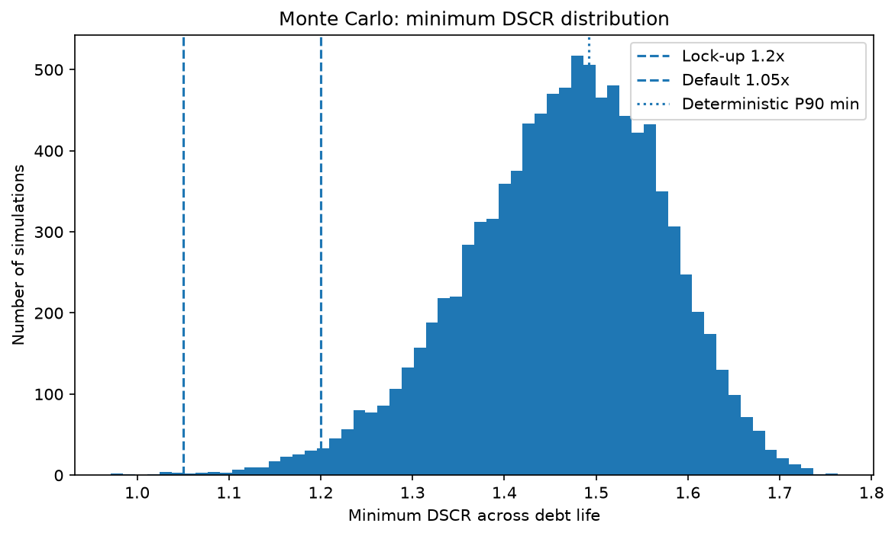

# solar-dscr-monte-carlo
markdown
# Solar Project DSCR: Monte Carlo Analysis

**Question:** How likely is a solar project to breach its DSCR covenants over the life of its debt, and how does that compare with a lender's deterministic P90 case?

**Note:** This is an illustrative project. All inputs are made up, and no real deal or bank data is used.

## Setup
- 20-year solar asset, 100 GWh/year P50 generation, flat £60/MWh tariff, £1.5m annual opex, 0.5% annual degradation
- £25m debt, 6% interest, level annuity repayment over 18 years
- Annual yield uncertainty: normal distribution, 8% standard deviation
- P90 derived as P50 x (1 - 1.2816 x 0.08)
- 10,000 simulated project lives, with covenants tested at 1.20x (lock-up) and 1.05x (default)

## Results
- Deterministic minimum DSCR: 1.74x (P50), 1.49x (P90)
- Simulated mean minimum DSCR: 1.46x; 5th percentile: 1.27x
- Probability of breaching lock-up (1.20x): about 1.6%
- Probability of breaching default (1.05x): about 0.1%

## Sensitivity
I tested how the result changes if yearly generation errors are shared across years rather than independent. Lock-up breach probability stayed between about 0.3% and 1.7% across all assumptions, and independent errors were the most conservative case for minimum DSCR.

## Limitations
- Normal distribution and constant sigma assumed
- No inflation, merchant tail or reserve accounts
- Annuity repayment rather than sculpted debt
- Minimum DSCR ignores how many years a project spends below lock-up

## Tools
Python (pandas, numpy, matplotlib), run in a Jupyter notebook.